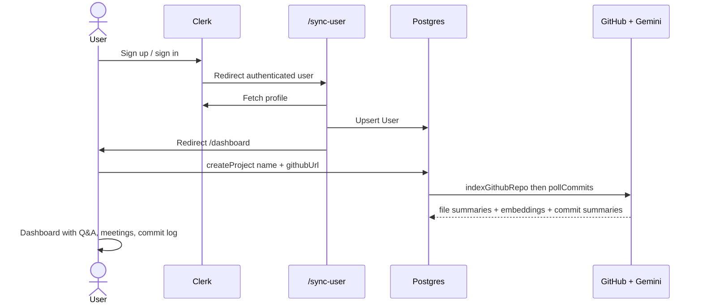
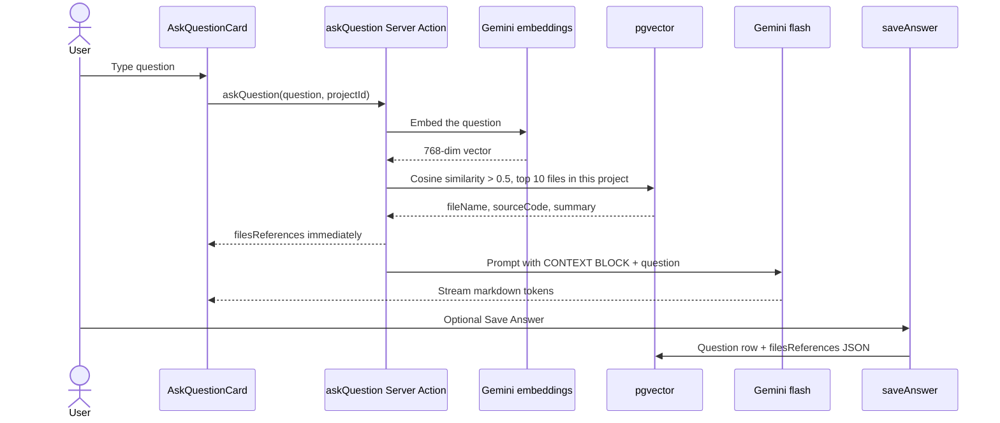
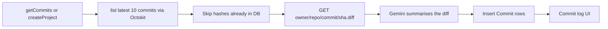
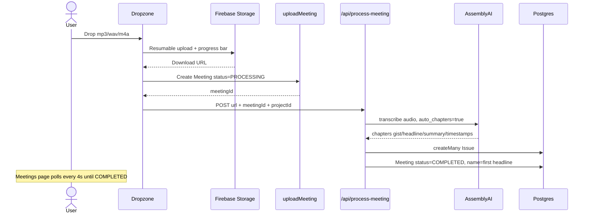
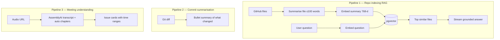

# BranchMind — Interview Presentation Notes

A student-level walkthrough of the project: what it is, why it exists, how it is built, and how to explain it in an interview.

---

## 1. One-line pitch

**BranchMind is a full-stack AI product that turns a GitHub repository into a searchable knowledge base, and turns team meetings into structured action items.**

In simpler words: you paste a GitHub URL, the app reads the code, and then you can ask questions like “where is login handled?” and get an answer with the actual files. You can also upload a meeting recording and get AI-generated chapter summaries.

This is not a chatbot wrapped around a UI. It is a real product with auth, a database, file storage, background-ish jobs, vector search, and three separate AI pipelines.

---

## 2. The problem we are solving

Joining a codebase is slow. Three things make it worse:

1. **Commit messages are often useless.** “fix stuff”, “wip”, “update”. A teammate cannot tell what actually changed without opening the diff.
2. **Codebases are too large to read linearly.** A new intern cannot grep their way to understanding “how does auth work?” They need a guide who has already read the repo.
3. **Meetings produce no durable knowledge.** A 40-minute standup recording sits in Drive. Nobody rewatches it. Action items disappear.

Existing tools each solve one slice:

| Tool | What it does | What it misses |
| --- | --- | --- |
| GitHub | Hosts code and diffs | No natural-language Q&A over the repo |
| ChatGPT / Gemini chat | Answers questions | Has no *your* repo unless you paste files |
| Otter / Fireflies | Transcribes meetings | Not tied to the project the meeting was about |
| Sourcegraph / Copilot | Code search / IDE help | Not a team product with meetings + commit history in one place |

BranchMind puts **repo understanding + commit memory + meeting memory** in one project workspace that a team can share.

---

## 3. Who it is for

- Interns / new hires onboarding onto a repo
- Small teams that want a shared “ask the codebase” history
- Anyone who wants AI summaries of recent commits without reading every diff
- Teams that record standups / planning calls and want chapters + issues extracted automatically

---

## 4. What the product actually does (features)

A signed-in user can:

1. **Create a project** by giving it a name and a GitHub URL (optional GitHub token for private repos).
2. **See AI-summarized commits** for that repo (latest 10, then new ones as they appear).
3. **Ask a question** about the codebase. The answer streams in markdown. Matching source files are shown as tabs with syntax highlighting. The Q&A can be saved.
4. **Browse saved questions** on the Q&A page (team knowledge base).
5. **Upload a meeting audio file** (mp3 / wav / m4a, up to 50 MB). The app transcribes it and splits it into chapter-style “issues”.
6. **Invite teammates** with a join link. They land in the same project.
7. **Archive a project** (soft delete — it disappears from the list but is not hard-deleted).

The sidebar also has a Billing item. The `User` model has a `credits` field defaulting to 150. Billing UI is not fully built yet — that is the SaaS hook for later (charge credits for indexing / questions / meeting minutes).

---

## 5. Tech stack

This started from **Create T3 App** (Next.js + TypeScript + tRPC + Prisma + Tailwind) and then grew into an AI product.

```text
┌─────────────────────────────────────────────────────────────┐
│                         CLIENT                              │
│  Next.js 15 App Router · React 19 · Tailwind · shadcn/ui    │
│  TanStack Query · tRPC React · Clerk components             │
└────────────────────────────┬────────────────────────────────┘
                             │ tRPC (typed RPC) + Server Actions
┌────────────────────────────▼────────────────────────────────┐
│                         SERVER                              │
│  Next.js Route Handlers · tRPC routers · Clerk middleware   │
│  Prisma ORM · Zod validation · Vercel AI SDK streaming      │
└──────┬──────────┬──────────┬──────────┬──────────┬──────────┘
       │          │          │          │          │
       ▼          ▼          ▼          ▼          ▼
   PostgreSQL   Gemini    GitHub     AssemblyAI   Firebase
   + pgvector   (LLM +    (Octokit   (speech →    Storage
                embed)    + LangChain chapters)   (audio files)
                          loader)
```

### Stack table (say this in interviews)

| Layer | Choice | Role |
| --- | --- | --- |
| Framework | Next.js 15 (App Router), React 19 | UI + API in one app. Server Components, Server Actions, Route Handlers. |
| Language | TypeScript | End-to-end types from DB → API → UI. |
| API | tRPC + SuperJSON | Typed procedures instead of hand-written REST. Dates/JSON survive the wire. |
| Client data | TanStack Query | Caching, refetch, polling meeting status every 4 seconds. |
| Auth | Clerk | Sign-in / sign-up, session, `UserButton`, middleware protection. |
| Database | PostgreSQL + Prisma | Relational data (users, projects, commits, questions, meetings). |
| Vectors | `pgvector` (`vector(768)`) | Semantic search in the same database. No extra vector DB. |
| LLM | Google Gemini (`gemini-2.5-flash`, `gemini-1.5-flash`) | Commit summaries, file summaries, Q&A generation. |
| Embeddings | Gemini `text-embedding-004` | 768-dim vectors for RAG. |
| Repo ingest | LangChain `GithubRepoLoader` | Recursively load files from GitHub. |
| GitHub API | Octokit | List commits. Axios for `.diff` files. |
| Speech | AssemblyAI (`auto_chapters: true`) | Transcript + chapter headlines / gists / summaries. |
| File storage | Firebase Storage | Meeting audio upload with progress %. |
| Validation | Zod | Input schemas on tRPC and the meeting API. |
| UI | Tailwind + shadcn/Radix | Sidebar, dialogs, cards, dropzone, markdown, syntax highlighter. |
| Env safety | `@t3-oss/env-nextjs` | Fail at boot if `DATABASE_URL` is missing. |

External services we depend on:

- **Clerk** — identity
- **Google AI** — generation + embeddings
- **GitHub** — source of truth for code and commits
- **AssemblyAI** — speech understanding
- **Firebase** — blob storage for audio
- **PostgreSQL** — system of record + vector index

That combination is why this can be marketed as a **full-stack AI product**: frontend, backend, auth, storage, third-party AI APIs, and a retrieval system, not just a prompt demo.

---

## 6. High-level architecture

```mermaid
flowchart TB
    subgraph User["User"]
        Browser[Browser]
    end

    subgraph App["BranchMind Next.js app"]
        MW[Clerk middleware]
        UI[Protected pages]
        tRPC[tRPC projectRouter]
        SA[Server Action askQuestion]
        API["POST /api/process-meeting"]
        Sync[/sync-user]
        Join[/join/:projectId]
    end

    subgraph Data["Data plane"]
        PG[(PostgreSQL + pgvector)]
        FB[Firebase Storage]
    end

    subgraph AI["AI / external APIs"]
        Gemini[Gemini LLM + embeddings]
        GH[GitHub API]
        AA[AssemblyAI]
    end

    Browser --> MW --> UI
    UI --> tRPC
    UI --> SA
    UI --> API
    UI --> Sync
    UI --> Join

    tRPC --> PG
    tRPC --> GH
    tRPC --> Gemini
    SA --> Gemini
    SA --> PG
    API --> AA
    API --> PG
    UI --> FB
```

Everything that is not `/sign-in` or `/sign-up` is behind Clerk. After login, `/sync-user` upserts the Clerk user into our `User` table, then redirects to `/dashboard`.

---

## 7. Data model (why it looks like this)

```mermaid
erDiagram
    User ||--o{ UserToProject : joins
    Project ||--o{ UserToProject : has
    Project ||--o{ Commit : has
    Project ||--o{ SourceCodeEmbedding : has
    Project ||--o{ Question : has
    Project ||--o{ Meeting : has
    User ||--o{ Question : asks
    Meeting ||--o{ Issue : contains

    User {
        string id
        string emailAddress
        int credits
    }
    Project {
        string id
        string name
        string githubUrl
        datetime deletedAt
    }
    Commit {
        string commitHash
        string summary
    }
    SourceCodeEmbedding {
        vector summaryEmbedding
        string sourceCode
        string fileName
        string summary
    }
    Question {
        string question
        string answer
        json filesReferences
    }
    Meeting {
        string meetingUrl
        enum status
    }
    Issue {
        string start
        string end
        string gist
        string headline
        string summary
    }
```



Design notes you can defend:

- **`UserToProject` is a join table** with `@@unique([userId, projectId])`. Many users can share one project. That is how invite/join works without copying the repo index.
- **`deletedAt` on Project** is soft delete. Archive hides the project (`deletedAt: null` filter) without wiping embeddings, commits, or meetings. Safer, reversible.
- **`SourceCodeEmbedding.summaryEmbedding` is `Unsupported("vector(768)")`**. Prisma does not have a first-class vector type, so we store the vector with raw SQL after insert. The rest of the row is still Prisma-managed.
- **We embed the *summary*, not the raw file.** Search is “which file is *about* this?” then we still return the source code for the LLM and the UI.
- **`Question.filesReferences` is JSON.** We snapshot the retrieved files at answer time so a saved Q&A stays reproducible even if the index later changes.
- **`Meeting.status` is `PROCESSING | COMPLETED`.** The UI polls until chapters exist.
- **`User.credits`** is the billing seed. Default 150. Not wired to deductions yet — mention it as the monetization path.

`User.id` is the Clerk `userId`. We do not invent a second identity.

---

## 8. User flows (start to finish)

### 8.1 Sign up → first project



On create:

1. Insert `Project` and a `UserToProject` row for the creator.
2. **Index the repo** (load files → summarize each → embed summary → store).
3. **Poll commits** (latest 10 hashes → fetch diffs → summarize → store).

Both happen in the same mutation, so when create returns, the project is already useful. Tradeoff: create can be slow on a large repo (see design choices).

### 8.2 Ask the codebase (RAG)

This is the core AI feature.



Retrieval SQL (cosine similarity via pgvector):

```sql
SELECT "fileName", "sourceCode", "summary",
  1 - ("summaryEmbedding" <=> $query::vector) AS similarity
FROM "SourceCodeEmbedding"
WHERE 1 - ("summaryEmbedding" <=> $query::vector) > 0.5
  AND "projectId" = $projectId
ORDER BY similarity DESC
LIMIT 10
```

`<=>` is cosine distance. `1 - distance` is similarity. Threshold `0.5` drops weak matches. Limit `10` caps prompt size.

The prompt is **grounded**: “If the context does not provide the answer, say you don’t know. Do not invent anything not in the context.” That is how we reduce hallucination for an interviewer who will ask “how do you stop the model from making up APIs?”

Answers stream with Vercel AI SDK (`streamText` + `createStreamableValue` / `readStreamableValue`) so the dialog fills in token by token instead of waiting for the full completion.

### 8.3 Commit intelligence



`getCommits` also **kicks off a background poll** (`pollCommits(...).then().catch(...)`) and immediately returns existing rows. Opening the dashboard refreshes summaries without a cron job. New commits appear on later visits.

`Promise.allSettled` is used so one failed diff/summary does not drop the whole batch.

### 8.4 Meeting intelligence



`maxDuration = 300` on that route exists because transcription is slow. On Vercel, serverless functions otherwise die around 10 seconds. This is a real production constraint, good to mention.

### 8.5 Team invite

Invite copies `{origin}/join/{projectId}`. The join page:

1. Ensures the Clerk user exists in our `User` table.
2. Inserts `UserToProject` (unique constraint → “already in project” is a no-op).
3. Redirects to dashboard.

The new member sees the **same embeddings, commits, questions, meetings**. We do not re-index. That is the point of modeling Project as a shared resource.

---

## 9. The three AI pipelines (this is the “full-stack AI product” story)

Interviewers hear “we used AI” and assume one ChatGPT call. BranchMind has three pipelines with different models and jobs.



| Pipeline | Input | Model / API | Output stored |
| --- | --- | --- | --- |
| Indexing | Source file (first 10k chars) | Gemini 2.5 Flash + `text-embedding-004` | `summary`, `sourceCode`, `summaryEmbedding` |
| Q&A | Question + retrieved files | Embed question, then Gemini 1.5 Flash stream | Optional `Question` row |
| Commits | `.diff` text | Gemini 2.5 Flash | `Commit.summary` |
| Meetings | Audio URL | AssemblyAI + auto chapters | `Issue` rows |

Why different tools:

- **Gemini for text.** Cheap, fast, good at code and diffs. Embeddings are the same vendor so one API key.
- **AssemblyAI for audio.** LLMs are not a speech-to-text engine. Chapter detection (`gist`, `headline`, `summary`, start/end) is a product feature of the transcription API. Using the right specialist model is a better design than “dump a transcript into Gemini and hope”.

Retry policy on Gemini calls: 3 attempts, **exponential backoff** (1s, 2s, 4s) on rate-limit errors, plus a 2s delay before each call to stay under free-tier limits. That is production thinking, not a tutorial `await model.generateContent`.

---

## 10. System design choices — and why they were the right call for this project

This section is the one interviewers care about. For each choice: **what we picked, what we did not pick, why.**

### 10.1 One Next.js app instead of split frontend/backend

**Picked:** Monolith on Next.js App Router.

**Not picked:** React SPA + Express, or Python FastAPI + separate UI.

**Why:** One deploy, one TypeScript codebase, Server Actions for streaming RAG, Route Handlers for long meeting jobs, React Query on the client. For a student product and for Vercel, this is faster to ship and easier to demo. A split stack would add CORS, duplicate types, and two deploys without helping the core RAG problem.

### 10.2 tRPC instead of REST / GraphQL

**Picked:** tRPC procedures (`createProject`, `getCommits`, `saveAnswer`, …) with Zod inputs.

**Why:** The UI calls `api.project.getMeetings.useQuery` and TypeScript already knows the shape, including `issues`. No OpenAPI file, no codegen step. Auth is a `protectedProcedure` middleware — if Clerk session is missing, every mutation fails the same way.

REST would have been fine, but we would hand-write URLs and response types. GraphQL is heavier than this app needs.

Meeting processing is **not** tRPC. It is a Route Handler because we need `maxDuration = 300` and a fire-and-forget POST from the client after upload. That is a good example of “use the right interface for the job”.

### 10.3 Clerk instead of NextAuth / homemade JWT

Create T3 App ships with NextAuth in the README, but this app uses **Clerk**.

**Why:** Hosted sign-in UI, social logins, session in middleware, `UserButton`. We only sync profile fields into Postgres. Identity is not a feature we wanted to build.

Tradeoff: vendor lock-in and a third-party dependency on the critical path. For a product demo and a small team, that is the correct trade.

### 10.4 PostgreSQL + pgvector instead of Pinecone / Chroma / Weaviate

This is the most important data-plane choice.

**Picked:** Same Postgres that holds users and projects, with the `vector` extension. Embedding written with `$executeRaw`, search with `$queryRaw`.

**Why it is optimal here:**

- One database to backup, migrate, and reason about.
- `projectId` filter is a normal SQL `WHERE`. Metadata filtering in a separate vector DB is extra glue.
- Transactions: we insert the row, then set the vector. Relational integrity stays with Prisma.
- Cost and ops: no second cloud bill, no another dashboard.
- 768 dimensions match `text-embedding-004`. We are not pretending to need a billion-scale ANN service.

**When we would switch:** millions of files, p95 search in the low milliseconds, or multi-tenant isolation that Postgres cannot give us cheaply. Then Pinecone / pgvector + IVFFlat/HNSW tuning / a dedicated search service. For repo-sized indexes (hundreds to a few thousand files per project), exact / Postgres cosine search is enough.

### 10.5 Embed summaries, not raw source

Naive RAG: chunk every file into 500-token pieces, embed all chunks.

**We did:** For each file, ask Gemini for a **≤100 word purpose summary**, embed *that*, store full `sourceCode` next to it.

**Why:**

- A question like “where is Stripe billed?” matches a summary “handles checkout and Stripe webhooks” better than a random 40-line chunk of imports.
- Fewer embedding calls (one per file, not N chunks).
- Prompt context still includes **real code**, because we retrieve `sourceCode` after the similarity search.
- Summaries are truncated input (10k chars) so huge generated files do not blow the context window during indexing.

**Tradeoff:** Fine-grained “what does line 412 do?” may miss if the summary is too coarse. Chunking + hybrid search (keyword + vector) would be the next upgrade. For onboarding-style questions, file-level retrieval is the right granularity.

### 10.6 Grounded RAG, not “chat with the whole internet”

The Q&A prompt wraps retrieved files in `START CONTEXT BLOCK` / `END OF CONTEXT BLOCK` and forbids answering from outside that block.

**Why:** A code assistant that invents a function that does not exist is worse than “I don’t know”. Showing **code references** in the UI makes the answer auditable. That is how you sell trust, not just fluency.

Similarity threshold `0.5` is a precision knob. If nothing is similar, context is empty and the model should refuse.

### 10.7 Streaming answers (AI SDK RSC)

**Picked:** `streamText` + streamable values from a Server Action.

**Why:** RAG + generation can take several seconds. A spinner for the whole answer feels broken. Streaming is the expected UX for AI products (ChatGPT, Copilot). Server Actions keep the Gemini key on the server.

### 10.8 LangChain only as a loader, not as an agent framework

We use `@langchain/community` **GithubRepoLoader** (recursive, ignore lockfiles, concurrency 5, optional token).

We do **not** use LangChain agents, chains, or their vector stores.

**Why:** Loaders are a solved, boring problem (ignore `package-lock.json`, walk the tree). Orchestration for RAG is ~40 lines of our own SQL + prompt. Owning that loop is easier to explain and debug in an interview than a LangChain abstraction.

### 10.9 Lazy commit polling instead of webhooks / cron

**Picked:** When someone loads commits, also poll GitHub for new hashes.

**Why:** Zero infra (no GitHub App webhook endpoint, no cron). Good enough for a dashboard that people open during work.

**Tradeoff:** No live updates if nobody opens the app. Duplicate work if many users refresh. Next step for a real SaaS: GitHub App + webhook `push` events + a queue.

We only keep **10 latest** commits per poll. That bounds Gemini cost.

### 10.10 Firebase Storage for audio, not Postgres or the Next.js server

Audio files are tens of megabytes. Putting them in Postgres is wrong. Uploading through the Next.js server would hit body-size and timeout limits.

Client uploads to Firebase with `uploadBytesResumable` and a circular progress bar. The app stores the **download URL**. AssemblyAI fetches that URL itself. Our server never pipes the bytes.

### 10.11 AssemblyAI auto-chapters vs “LLM, please summarise this transcript”

Chapters give `start`, `end`, `gist`, `headline`, `summary` — which map 1:1 to the `Issue` model and the meeting UI cards.

That is structured extraction from the speech vendor, not a second prompt we have to maintain. The meeting page becomes a list of issues, not a wall of transcript text.

### 10.12 Soft delete, unique membership, saved Q&A as snapshots

- Archive = `deletedAt`, not `DELETE FROM`.
- Membership uniqueness prevents double-join errors.
- Saving an answer stores the retrieved files. The Q&A page is a **team wiki generated from RAG**, not just chat logs.

### 10.13 Resilience: `allSettled`, retries, polling UI

- Indexing uses `Promise.allSettled` so one bad file does not fail the project.
- Gemini wrappers retry rate limits.
- Meetings page `refetchInterval: 4000` until `COMPLETED`.
- Unprocessed commits are filtered by existing `commitHash`.

These are the difference between a demo that works on a 5-file repo and a product that survives GitHub + Gemini + AssemblyAI all being flaky.

### 10.14 Credits field even without billing

SaaS AI products are metered: indexing tokens, questions, audio minutes. Putting `credits` on `User` early means the data model is ready. The sidebar Billing link is the product story; implementation can come after the three AI loops are solid.

---

## 11. Request path inside the codebase (for “walk me through the code”)

Know these files by name.

| Concern | File |
| --- | --- |
| Schema | `prisma/schema.prisma` |
| tRPC context, Clerk-protected procedures | `src/server/api/trpc.ts` |
| All project APIs | `src/server/api/routers/proejct.ts` |
| Repo load + embed | `src/lib/github-loader.ts` |
| Commit poll + diffs | `src/lib/github.ts` |
| Gemini summarise / embed | `src/lib/gemini.ts` |
| RAG + streaming | `src/app/(protected)/dashboard/actions.ts` |
| Meeting transcription | `src/lib/assembly.ts`, `src/app/api/process-meeting/route.ts` |
| Audio upload | `src/lib/firebase.ts` |
| Auth gate | `src/middleware.ts` |
| User sync | `src/app/sync-user/page.tsx` |
| Selected project in localStorage | `src/hooks/use-project.ts` |

App routes:

| Path | Purpose |
| --- | --- |
| `/sign-in`, `/sign-up` | Clerk |
| `/sync-user` | Upsert user, go to dashboard |
| `/create` | Link a GitHub repo |
| `/dashboard` | Ask, upload meeting, commit log, invite, archive |
| `/qa` | Saved questions |
| `/meetings`, `/meetings/[meetingId]` | List + chapter issues |
| `/join/[projectId]` | Accept invite |
| `/api/trpc/*` | tRPC |
| `/api/process-meeting` | Long-running transcription |

---

## 12. End-to-end story you can tell in 90 seconds

> BranchMind is an AI workspace for a GitHub project. You connect a repo. We crawl the files with LangChain, ask Gemini to summarise each file, and store a 768-dimension embedding in Postgres with pgvector. When you ask a question, we embed the question, find the closest files with cosine similarity, and stream a grounded Gemini answer plus the source code. In parallel we pull recent commits, fetch the diffs, and store AI summaries so the dashboard is a readable history. You can also drop a meeting recording into Firebase; AssemblyAI transcribes it with auto-chapters and we save those as issues. Auth is Clerk, the API is tRPC, the UI is Next.js. So it is a full product: identity, relational data, vector search, object storage, and three AI pipelines — not a single prompt in a notebook.

---

## 13. How to market it as a full-stack AI product

Use this framing:

1. **Full stack:** Auth, multi-tenant-ish projects (shared via join table), CRUD, file uploads, background-length jobs, typed API, production DB.
2. **AI-native, not AI-sprinkled:** The product does not work without models. Indexing, commit log, Q&A, and meetings are all model-backed.
3. **Retrieval, not only generation:** We built a RAG system (embed → search → cite → generate). That is the industry pattern behind Copilot Chat / Notion AI / Glean.
4. **Multimodal-ish:** Text (code, diffs, questions) and **audio** (meetings). Two modalities, one project.
5. **Human-in-the-loop:** Save answer, show file tabs, show chapter timestamps. The user can verify.
6. **SaaS shape:** Credits, team invites, archive, per-project isolation of vectors.

Avoid saying “ChatGPT clone”. Say **“RAG over a customer’s GitHub repo, plus meeting intelligence, in a team workspace.”**

---

## 14. Likely interview questions and tight answers

**Why not fine-tune a model on the repo?**  
Fine-tuning is slow, expensive, and goes stale every commit. RAG keeps the source of truth in Git + Postgres and updates by re-indexing. For factual code questions, retrieval beats weights.

**Why cosine similarity on summaries?**  
We want semantic match (“authentication” vs `src/lib/session.ts`) not only keyword match. Summaries are a compact semantic fingerprint of each file.

**How do you isolate tenants?**  
Every embedding/commit/question/meeting row has `projectId`. Search SQL always filters `projectId`. Users only see projects they have a `UserToProject` row for.

**What if Gemini is down?**  
Indexing/Q&A/commits fail that path; meetings still work (AssemblyAI). Retries cover rate limits. `allSettled` covers partial indexing. Honest answer: we do not have a second-model fallback yet.

**How would you scale indexing?**  
Move `indexGithubRepo` off the request onto a queue (Inngest / BullMQ). Parallelise embedding with a concurrency limit. Incremental index on `git clone` + hash of file contents so unchanged files are skipped. Add an IVFFlat/HNSW index on `summaryEmbedding` when row count grows.

**Security?**  
Clerk `auth.protect()` on all non-public routes. tRPC `protectedProcedure`. Meeting API checks `userId`. GitHub token is optional and used server-side for private clones. Gemini key is server-only. Meeting URLs are Firebase download URLs — in a production hardening pass we would use signed URLs and authz checks that the meeting belongs to a project the user is in.

**Biggest bottleneck today?**  
Create-project is synchronous: load entire repo, summarise file-by-file with 2s delays. That is correct for a prototype and the first thing to move to a job queue.

**Why T3?**  
Typed vertical slice: Prisma schema → tRPC → React Query hook. Fewer bugs at the API boundary, which matters when payloads include embeddings metadata and JSON file references.

---

## 15. Honest limitations (saying these makes you look senior)

- Create project can time out on large repos (synchronous index).
- Branch is hardcoded to `main`.
- Billing page is not implemented; credits are unused.
- `getCommits` is not a real worker; it depends on someone opening the dashboard.
- Meeting `process-meeting` is triggered from the client; if the tab closes, processing might not finish (should be a server queue).
- Similarity search has no ANN index yet (fine at current size).
- Q&A does not keep multi-turn chat history in the model context (each question is standalone; saved questions are a log, not a thread).
- `postRouter` is leftover T3 scaffolding.
- Indexing is sequential per file (rate-limit friendly, not throughput friendly).

If asked “what would you build next?”: job queue, incremental indexing, hybrid search, credit metering, GitHub webhooks, conversation memory, and authorization checks on meeting/project IDs in every procedure.

---

## 16. Demo script (if they ask you to show it)

1. Sign in (Clerk).
2. Create project → paste a public GitHub URL → wait for index.
3. Dashboard: scroll commit log, point at an AI summary vs the raw message.
4. Ask: “Which file should I edit to change the homepage?” Show streaming answer + file tabs.
5. Save answer → open Q&A page.
6. Upload a short mp3 → Meetings → Processing badge → issues with timestamps.
7. Invite link → explain join table, no re-index.

---

## 17. Mental model to close with

```text
GitHub repo  ──index──►  vectors + summaries   ──ask──►  grounded answers
     │                         │
     └──commits──► AI diff summaries          team workspace (Clerk + join links)
                          │
Meeting audio ──store──► Firebase URL ──transcribe──► chapter issues
```

**Point of the project:** make a GitHub project understandable in natural language, keep that understanding in a database, and attach meeting memory to the same workspace.

**Stack:** T3 (Next.js, tRPC, Prisma, Tailwind) + Clerk + Postgres/pgvector + Gemini + LangChain loader + Octokit + AssemblyAI + Firebase.

**Why the design is right for the problem:** one database for relational + vector data, RAG on file summaries, streaming grounded generation, specialist speech API for meetings, and a team-scoped project model — the smallest architecture that is still a real AI product.

---

## 18. Answers to the questions in `questions.md`

These answers follow the code as it is today (`src/lib/github.ts`, `src/lib/github-loader.ts`, `src/lib/gemini.ts`, `src/app/(protected)/dashboard/actions.ts`, `src/lib/assembly.ts`, `prisma/schema.prisma`). Where the app does not do something, that is stated plainly, with what a follow-up would look like and whether a fourth-year student could build it.

### What problem this app actually solves

GitHub already stores code. ChatGPT already answers questions if you paste files in. Copilot already helps inside an editor. Otter and Fireflies already turn meetings into notes. BranchMind does not replace any of those.

The problem it is aimed at is narrower: a new person joins a small repo and has three separate piles of information that do not talk to each other.

1. The code is on GitHub, but reading it file by file is slow, and a general chatbot has not seen this repo.
2. The commit log often says “wip” or “fix”, so the history is hard to skim.
3. A meeting recording sits in Drive and nobody rewatches it.

BranchMind puts those three things in one project that teammates can join:

- Ask a question and get an answer plus the files it used, without pasting the repo into a chat box.
- See a plain-language summary of what a recent diff actually changed.
- Turn an uploaded recording into chapter cards on the same project.

That combination is the product. Each feature on its own is a smaller version of a tool that already exists. The shared workspace is the idea. Two honest limits belong in the same sentence: the code index is a one-time snapshot, so it goes stale after later commits, and meeting chapters are not linked to files or commits. The meetings and the code sit next to each other in the UI. They are not one knowledge base yet.

If an interviewer asks “so is this just a wrapper?”, the fair answer is: the pieces are known patterns (RAG, diff summaries, speech-to-chapters). The work was wiring them into a real app with login, a shared project, a database, and citations. The learning outcome is below, after the technical answers.

### Commit summaries: what we look at, and what happens after the first ten

Yes. We do not summarise the commit message by itself. We look at the diff.

On project creation, and again whenever the commit log is loaded, `getCommitHashes` asks GitHub for the 10 newest commits (`per_page: 10`). For each of those that is not already stored, `summeriseCommit` downloads `{githubUrl}/commit/{hash}.diff` and sends that diff to Gemini (`aiSummariseCommit`). The model is told how a diff works (`+` added, `-` removed) and returns a short bullet summary. The commit log shows the original message and that summary under it.

Older summaries stay in the `Commit` table. Nothing deletes them. “Latest 10” is only the window we ask GitHub for. `filterUnprocessCommits` skips any hash already saved, so we do not pay Gemini twice for the same commit.

They are not realtime. There is no websocket, and the commit log has no timer. `getCommits` starts `pollCommits` in the background and immediately returns the rows already in the database. New summaries show up the next time that query runs: refresh the page, or come back after the cache is stale (TanStack Query’s `staleTime` is 30 seconds, and it refetches when the window is focused). If the poll is still running on that first refresh, you may need one more refresh to see the new rows.

There is a gap. If fifteen commits land while nobody opens the app, the next poll only sees GitHub’s current top 10. The five that fell out of that window are never summarised. A student-sized fix is a GitHub webhook, or a scheduled job that pages further back. A larger team would add a queue, retries, and a backfill. The webhook itself is a reasonable fourth-year follow-up. Making that pipeline reliable for a busy monorepo is the part that needs planning.

### What TypeScript is doing here

TypeScript is JavaScript with a checker that knows the shape of your data before the program runs.

“Type safe” in this project means: if the server says a meeting issue has `gist`, `headline`, `start`, `end`, and `summary`, the editor already knows those fields on the page that renders the card. The issue card is typed from the API itself:

`RouterOutputs["project"]["getMeetingById"]["issues"][number]`

Write `issue.gyst` and the editor marks it wrong before you open the browser. `saveAnswer` must be called with `projectId`, `question`, `answer`, and `filesReferences`. Leave `projectId` out and `npm run typecheck` fails.

Without that, the page would still compile. You would find the mistake when someone clicks a card and a value is `undefined`, or when a request writes a bad row. Prisma generates types from `schema.prisma`, tRPC carries those types to the React hooks, and the components use them. A rename in the schema shows up as errors in the UI.

Types do not prove the AI answer is correct. They prove the app agrees with itself about field names, nulls, and which arguments a call needs.

### Why tRPC, and how that differs from REST

REST names a URL and a verb. You agree, in writing, what the JSON looks like:

```http
POST /api/projects
{ "name": "BranchMind", "githubUrl": "https://github.com/someone/repo" }

GET /api/projects/abc123/commits
```

The UI then has its own hand-written type for the response. If the server renames `commitMessage` to `message`, the UI still builds, and the screen shows a blank message.

tRPC is a function call over HTTP. In this app the UI writes:

```ts
api.project.getCommits.useQuery({ projectId })
api.project.createProject.useMutation({ name, githubUrl, githubToken })
```

Zod checks the input on the server (`projectId` must be a string). TypeScript infers what comes back. Rename `commitMessage` in the router and every component that reads it fails the typecheck. There is no separate OpenAPI file to keep in sync, because the browser and the server are one TypeScript codebase.

That is why it fits BranchMind. We do not publish this API to a mobile app or to other companies. The bugs we wanted to avoid are “the button sent the wrong JSON.” tRPC removes that class of bug for `createProject`, `getCommits`, `saveAnswer`, `uploadMeeting`, and the other project calls.

The meeting job is ordinary REST on purpose: `POST /api/process-meeting`, called with axios after the file upload. That route needs `maxDuration = 300` so Vercel does not kill a long transcription. Same app, two styles, each used where it fits.

GraphQL would also be typed. It adds a schema language, resolvers, and a client. This app has a handful of procedures, so that extra machinery does not pay for itself.

A fourth-year student can explain and use this. Designing a public REST API with versioning, for many external clients, is a different and larger job. We did not need that.

### Why TanStack Query

TanStack Query is the browser cache for data that lives on the server. The tRPC React hooks in this repo are built on it (`@trpc/react-query`), which is why it is here rather than a random extra library.

What we use it for:

- `getProjects`, `getCommits`, and `getQuestions` are cached. Moving between dashboard and Q&A does not refetch on every render. Cached data is treated as fresh for 30 seconds.
- The meetings list and the meeting detail page set `refetchInterval: 4000`. While AssemblyAI is working, the page asks the server every 4 seconds until `status` is `COMPLETED` and the chapter cards exist. Loading state and “poll until done” come from the query library.
- After a meeting is deleted or an answer is saved, `useRefetch` calls `queryClient.refetchQueries` so the open lists update.

You could replace it. `useEffect` plus `fetch` plus `useState` can load data. SWR can cache and poll too. You would rewrite every `useQuery` / `useMutation` and reimplement the 4-second meeting poll. The product would not get better. TanStack is the usual tool in this stack, and the meeting status poll is the feature that would be tedious to hand-write.

### Audio, transcript, and Firebase

The raw transcript is not stored in Postgres. The audio is stored in Firebase. Both are not kept as a pair of copies of the same words.

What actually happens:

1. The browser uploads the mp3, wav, or m4a (max 50 MB) straight to Firebase and gets a download URL.
2. `uploadMeeting` saves a `Meeting` row with that URL and `status: PROCESSING`.
3. AssemblyAI downloads the file from the URL, transcribes it, and builds chapters (`auto_chapters: true`).
4. We save the chapters as `Issue` rows: `start`, `end`, `gist`, `headline`, `summary`.
5. The code checks that `transcript.text` exists, then discards it. There is no transcript column.

The audio file is required before transcription, because AssemblyAI needs a URL to fetch. Uploading through Next.js would hit body-size and timeout limits, so the bytes go to Firebase and our server only stores the link.

After the chapters are saved, the UI never plays the audio. Keeping the file forever is unused by the current screens. Deleting it from Firebase once status is `COMPLETED` would be reasonable. Keeping it is also reasonable if the next feature is a play button or “transcribe again.” That delete-or-playback choice is a small student change. A company also has to decide retention, who may download the recording, and signed URLs instead of a public download link. The product choice is student-sized. The access-control and legal-retention version takes a team and a plan.

### How onboarding a repo actually works (and where chunking would be)

The loader walk is recursive. The AI steps are a straight loop, one file at a time. There is no chunking.

1. `GithubRepoLoader` walks the GitHub tree, including folders inside folders (`recursive: true`), on branch `main`, skipping lockfiles, with up to 5 downloads at once.
2. `generateEmbeddings` then uses a normal `for` loop. Each file waits for the previous one to finish. A 2 second pause sits in front of every Gemini call so the free tier is less likely to rate-limit.
3. `summariseCode` sends the first 10,000 characters of that file to Gemini and asks for a purpose summary of at most 100 words.
4. `generateEmbedding` sends that summary to `text-embedding-004` and gets back 768 numbers.
5. One `SourceCodeEmbedding` row is inserted with `summary`, `fileName`, `projectId`, and the full `sourceCode` the loader returned (the whole file text, not only the 10,000-character slice).
6. A raw SQL `UPDATE` sets `summaryEmbedding` on that same row. Prisma does not know how to write a `vector` column, so the vector is applied in a second statement.

So one file becomes one summary, one embedding, and one row. Chunking would mean splitting a long file into many pieces and embedding each piece. That function does not exist. The only cut is the 10,000-character cap on the text the summary model sees. The bottom of a long file can be stored in `sourceCode` and still be missing from the summary and the embedding.

Adding chunking is a plausible fourth-year upgrade: split on functions or on a character window, embed each chunk, and store several rows per file. Getting the split points right, and not blowing the prompt with too many chunks, takes experimentation. It is not a research project, and it is also not a one-hour change.

### How pgvector sits in this database

It is the same Postgres database as users, projects, and commits. `SourceCodeEmbedding` is a normal table. `summaryEmbedding` is one column on that table, type `vector(768)`. `fileName`, `sourceCode`, `summary`, and `projectId` are ordinary columns beside it.

They do not live in a separate vector database. A search is one SQL statement: filter `projectId`, compute cosine similarity, keep scores above 0.5, take 10. Because `projectId` is a foreign key on that same row, you can join to `Project` the same way you join any other table. The app’s search query does the filter in the `WHERE` clause rather than a separate join, which is the same idea.

`<=>` is pgvector’s cosine distance. We store similarity as `1 - distance`.

### Later commits do not update file summaries

No. A new commit writes a row in `Commit` only. `indexGithubRepo` runs once, inside `createProject`. Nothing opens `SourceCodeEmbedding` again.

If a later commit changes what a file does, the commit log can describe that diff, and the Q&A index still has the old summary, the old source, and the old embedding. Questions keep retrieving the snapshot from the day the project was created.

The follow-up is incremental indexing: read the diff, find the files that changed, summarise those again, embed again, and replace those rows. Also handle deletes and renames. That is a strong fourth-year next step, on the order of a few focused weeks if you also move it off the web request and onto a background job. A large team adds a queue, idempotency, cost limits, and tests around huge diffs. The design is student-scope. Operating it for every repo a company hosts is the long part.

### Summaries are per file, not a map of the whole repo

Yes. The prompt is: explain the purpose of this file, in at most 100 words, for a junior engineer. There is no second pass that says how the files work together.

A bird’s-eye view would be a new step: take the file summaries you already have and ask Gemini for one architecture overview, saved on `Project`. Writing that paragraph is a student feature. Keeping it true after every push is the same incremental-index problem as above. One overview paragraph is achievable. A map that stays accurate on a large monorepo is what teams at tools like Sourcegraph and Cursor spend a long time on.

### Why the current design fits short repos

Indexing runs inside the create-project request, one file after another, with a pause before the summary and another before the embedding. A repo of a few dozen files can finish while the user waits. A repo of hundreds of files can run for many minutes, and a hosted serverless function will time out. The loader also pulls the repo into memory, and each row stores the full source text.

At question time we paste up to 10 full files into the prompt. A few small files fit. Ten large files can overflow the model’s context. And because the summary only saw the first 10,000 characters, a long file’s embedding may not represent the rest of it.

Those are the concrete problems, before you even talk about vector-search speed.

A student can move indexing onto a background job and skip files whose contents have not changed. That makes medium repos usable. Doing this well for tens of thousands of files — ignore rules, chunking, incremental updates, cost caps — is multi-year product work at companies that do repo intelligence. You can explain the limit and ship the queue. The current code should not be described as ready for a huge repository.

### Saved Q&A answers after a later commit

They stay as they were saved. `saveAnswer` stores the question, the answer text, and `filesReferences` (the files retrieved at that moment) as a snapshot. The Q&A page reads those rows. A later commit does not edit them.

Asking the question again still searches the old file index, because embeddings are not refreshed. So a commit that would change the right answer never reaches the Q&A page, neither by editing the old card nor by a fresh ask.

A “Run again” button that calls `askQuestion` and replaces the row is a small student feature, and it only becomes truthful after incremental indexing exists. Showing “this answer was generated against commit abc123” is a bit more work and still reasonable for a student. A large product team treats that as answer versioning and builds it with tests and a reindex pipeline.

### The question-answering flow

This matches the code in `askQuestion`.

1. The user submits a question. The server action embeds that question with `text-embedding-004`, the same model used for file summaries, so both are 768-number vectors.
2. SQL searches `SourceCodeEmbedding` for this `projectId`, keeps cosine similarity above 0.5, orders by similarity, and takes 10 rows.
3. Each row brings back `fileName`, `sourceCode`, and `summary`.
4. Those are pasted into a context block. Gemini 1.5 Flash is told to answer only from that block, and to say it does not know if the context is not enough.
5. The answer streams into the dialog. The same files are shown in tabs.
6. Saving is a separate click. It writes the snapshot described above.

If no file scores above 0.5, the context is empty and the model is supposed to refuse.

### The meeting flow

Fireflies is not part of this app. It appears in the earlier notes only as an example of an existing meeting product. AssemblyAI does both the transcript and the chapters in one call.

1. The browser uploads the audio to Firebase and gets a URL.
2. tRPC creates the `Meeting` row (`PROCESSING`) and stores the URL.
3. The browser POSTs that URL to `/api/process-meeting`.
4. `processMeeting` calls AssemblyAI with `audio: meetingUrl` and `auto_chapters: true`.
5. Chapters come back with gist, headline, summary, and timestamps. Those become `Issue` rows.
6. The raw transcript text is not saved.
7. The meeting is marked `COMPLETED`, and its name becomes the first chapter headline.
8. The meetings page polls every 4 seconds until the badge clears and the cards show up.

So the database has the audio URL and the chapter cards. It does not have a stored full transcript next to them.

### Why pgvector is enough here, and what a dedicated vector database changes

At this size, pgvector is enough because there is one vector per file, and a student repo is often tens or a few hundred files. The query compares the question with the rows for that project. That is a small scan, and it can filter by `projectId` and return the source code in the same database. One backup, one connection string, and the vector cannot drift away from the `fileName` sitting beside it.

A dedicated vector database (Pinecone, Qdrant, Weaviate) is a separate service built to search a very large number of vectors quickly. It typically uses an approximate index (often called HNSW): instead of comparing the question with every stored vector, it jumps to a short list of likely neighbours. That matters when you have millions of vectors and many searches per second. Example: chunk every file of every customer repo into small pieces, so one company has tens of millions of vectors and the search has to return in a few milliseconds while people type.

The cost of that split is the thing this app relies on. In Pinecone you would store the vector plus some metadata, filter by `projectId` over there, then load `sourceCode` from Postgres with a second query. Delete a project in Postgres and you must also delete the vectors in the other service. Two systems can get out of date.

pgvector can also add an HNSW or IVFFlat index later, still inside Postgres. You do not have to leave Postgres just because a repo grows from 50 files to 5,000. The switch is worth it when the vector count and the search traffic justify another service to run.

For this project, a large repo fails first on indexing time and on stale files, not on the vector search. Choosing pgvector and being able to say that is the right fourth-year decision. Connecting Pinecone is also something a student can do in a short time, and it would not fix the bottleneck. Running a search fleet, tuning how often the approximate index misses the true nearest file, and keeping it consistent with Git is platform-team work.

### How you would evaluate the answers

The repo has no evals. Accuracy is not measured. Here is a concrete way to add that. A fourth-year student can do the first version in a few days on one repo they know. A company runs the same checks on every prompt change and pays people to grow the question set. You do not need a large eval platform to start.

1. Pick one repo you can judge yourself. This project is a fine choice.
2. Write 20 to 30 questions by hand, with an answer key you wrote, not the model. For each question write down:
   - the question
   - which file or files should be retrieved
   - one fact the answer must include (a function name, a route, a table)
   - one thing it must not invent
3. Score retrieval and the written answer separately. They fail for different reasons.
   - Retrieval: run only the embed-and-SQL step. Did the right file show up in the top 10? Was it the first result? If the right file never comes back, a better prompt cannot fix the answer.
   - Answer: run the full `askQuestion`. Mark each reply correct, partial, wrong, or made-up (it named a file or function that was not in the retrieved context). Grade them yourself first. A second model can grade later, and you should still check a sample of those grades by hand.
4. Record retrieval hit rate, answer accuracy, how often it says it does not know, and how long a question takes.
5. Change one thing, then run the same 30 questions again:
   - embed the start of the raw file instead of the summary
   - chunk long files and embed the chunks
   - move the 0.5 cutoff to 0.3 and to 0.7
   - retrieve 5 files instead of 10
   - add a simple filename keyword match and merge it with the vector results
6. Keep the version that retrieves the right files more often and invents less. A smoother paragraph with the wrong file is a worse system.
7. After incremental indexing exists, edit a file, add a few questions about that change, and check that the new answer matches the new code. That measures freshness. The app today would fail that test, and that is a useful result to be able to show.

A script plus a spreadsheet is enough to talk about this in an interview. LangSmith or Braintrust are wrappers around the same two scores. The dataset and the split between “did we fetch the right file?” and “did the paragraph stay faithful?” are the part worth building. Putting that script in CI so a prompt edit cannot ship when hit rate drops is a follow-up, and still in range for a student who already has the script.

### What you can say you learned, even though the product is not unique

The valuable part of this project is that the whole loop is yours and you can point at its limits.

- RAG as a pipeline you implemented: summarise a file, turn the summary into 768 numbers, store them beside the source, embed the question, search by cosine similarity, put the real code in the prompt, stream the answer, and show the files used.
- Why a summary embedding can beat embedding raw code for “where is login?”, and what you lose (details past the first 10,000 characters, and no chunk-level match).
- Why a vector can be a column in the same Postgres database, and what would have to be true before a separate vector service is worth it.
- Why a long transcription cannot live on the same short request as a button click, and why the UI polls.
- How a field on a Prisma model becomes the prop on a React card, through tRPC and TanStack Query.
- Why the code talks to flaky APIs with retries, `Promise.allSettled`, and “skip commit hashes we already stored.”

The strong interview close is: this is a shared workspace for asking a repo questions, reading recent diffs, and keeping meeting chapters, built as a full app. It does not beat Copilot or Fireflies at their own jobs. The index is a snapshot, meetings are not tied back to code, credits are unused, and there are no evals yet. The next serious steps are a background reindex, a small hand-built eval set, and only then any talk of a different vector database.

---

## 19. Follow-up: huge files, and how evals scale past one repo

### The context problem, stated precisely

There are two different cuts, and only one of them is the “10 files” blow-up.

**While indexing.** `summariseCode` sends only the first 10,000 characters of a file to Gemini. A 30,000-line file is still stored in full in `sourceCode`, but the summary and the embedding were built from the top of the file. Search can miss a function that lives at the bottom, because that function never entered the vector.

**While answering.** `askQuestion` loads at most 10 rows and pastes each row’s **entire** `sourceCode` into one prompt. It is not “10 times the context window.” It is one prompt that contains up to 10 complete files, plus their summaries. If similarity finds fewer than 10 files above 0.5, the prompt is smaller. If it finds 10 large files, the prompt is the sum of those 10 files.

A rough sense of size: a few dozen short files fit. One 30,000-line file is already hundreds of thousands of tokens. Ten files of that size are past even a 1-million-token window, and Gemini 1.5 Flash is what this app calls for answers. Before the hard limit, three other things get worse: the call gets expensive, it gets slow, and the model pays less attention to a relevant function buried in the middle of a huge paste. Stuffing more text in is not the same as the model using it.

Context size is the reason a single question fails on huge files. It is not the only reason a large repo fails. Create-project still walks every file inside the web request, with pauses, and that times out before anyone asks a question. Both belong in the answer.

### What real tools do instead of pasting whole files

They never put a 30,000-line file in the prompt just because the file was relevant. They put in the small slice that can answer the question. The usual pieces, which stack together:

1. **Chunk the file, and search chunks.** Split on functions or classes (an AST parser such as tree-sitter), or on a window of a few hundred lines with a small overlap so a function cut in half still appears whole in a neighbour chunk. Each chunk is embedded and stored with `fileName` plus a line range. A question retrieves the 5 to 20 closest chunks. A 30,000-line file might contribute one 80-line function. The other 29,920 lines stay in git and in the database, and they are not sent to the model.

2. **Spend a token budget, not a file count.** Decide the prompt may hold, for example, 8,000 tokens of code. Fill that budget with the best chunks and stop. “Top 10 files, however large” is the rule this app uses. “Best slices until the budget is full” is the rule production uses. A huge file cannot crowd out everything else, and it cannot overflow the window.

3. **Narrow, then zoom in.** First find candidate files with something cheap: path names, a short summary, or which symbols the question mentions. Then search chunks only inside those files, or only fetch the function bodies. Aider’s repo map is the compact version of this: the model sees signatures (function and class names) for a lot of the repo, and full source only for the few symbols that matter. Sourcegraph does the same job with a code graph plus chunk embeddings.

4. **Search in steps, the way a person would.** Cursor’s agent does not preload ten files. It can grep for a symbol, then read a line range of the file that matched, then open one more file if the first read was not enough. A 30,000-line file is handled by reading lines 1400–1550, not by loading the file. That is the current production pattern for coding agents. It uses more round trips and it stays inside the window.

5. **Hybrid search, then a rerank.** Exact names (“`askQuestion`”, “`processMeeting`”) should match even when the summary embedding is vague, so a keyword index sits beside the vector index. Retrieve a wider set (say 50 chunks), then a smaller reranker keeps the few that actually belong in the budget.

6. **Skip what should never be indexed.** Lockfiles, generated code, and vendored folders are ignored. Priority goes to the file the user has open, files imported by that file, and files touched in the latest commits.

A long context window is still used, as a complement. It lets the model read one large function, or several chunks, comfortably. It is not used as “paste the repository.” Teams learned that a bigger window makes a bad retrieval strategy more expensive, and the answers do not get more reliable in proportion.

For this project, chunking plus a token budget is the student-sized version of the fix. Multi-step tool use (grep, then read a line range) is how Cursor-style products do it, and it is a larger build: you are writing an agent loop, not only changing the SQL `LIMIT`.

### Evals: one golden set per customer repo is not how this ships

A hand-written list of questions and expected files is specific to the repo it was written about. The question “which file starts meeting transcription?” has a right answer in BranchMind and a nonsense answer in some other project. So that list cannot be copied onto every repo a user connects.

You also do not create that list for every repo. Production splits the job into a fixed benchmark, which is app-wide, and cheap checks, which run on any repo without a domain expert.

**The fixed benchmark (this is the generic test suite).** Pick a handful of repos once: this project, plus two or three public repos with different shapes (a small library, a web app, a monorepo). A person who knows those repos writes the questions and the expected files once. Every time the chunk size, the prompt, the cutoff, or the model changes, the same questions run again. The score answers “did the system get better or worse?” It does not answer “is every customer repo perfect?” Industry sets such as SWE-bench work the same way: a frozen collection of real repos and tasks, reused by everyone, not rebuilt per user.

That benchmark is repo-specific in its questions and app-wide in its job. You maintain it like a test suite. You add a repo to it when you care about a new shape of codebase. You do not add one when a user clicks “create project.”

**Checks that need no answer key (these run anywhere).** These are generic rules, so they apply to a repo nobody on the team has read:

- The files named in the answer must be files that were actually retrieved.
- A code snippet in the answer should appear in that retrieved context. If it does not, the model invented it.
- If retrieval returned nothing, the answer should be “I don’t know,” not a confident guess.
- After you ship incremental indexing: ask a question, change the file, reindex, ask again, and check that the cited lines changed. The label is “the file changed,” which git already knows.

**Synthetic questions, so you are not stuck writing them by hand.** Take a real function from any repo, ask a strong model “what question would lead a new teammate to this function?”, and record the source chunk as the expected retrieval hit. Then run retrieval and see if that chunk comes back. You can generate thousands of these on a repo you have never studied. They are noisier than a human rubric, so teams use them for coverage and keep the smaller human benchmark as the number they trust.

**What users do in production, which labels itself.** Thumbs up or down, whether the user opens the cited file, whether they ask the same question again in different words, whether a coding agent’s edit is accepted. That signal exists for every repo and costs no expert time. It is biased (people mostly rate bad answers), so it monitors the live system. It does not replace the frozen benchmark.

**Where the domain expert still is.** Experts write and refresh the benchmark. They also grade a sample of answers so you can check that an LLM judge agrees with a human. If the judge and the human disagree often, you cannot trust the judge to score every build. The expert is not in the loop for each customer repository.

**What a production team adds that is out of scope here.** A pull request that changes the prompt fails CI if recall on the benchmark drops past a set line. There is a holdout set of questions you do not peek at while tuning, so you do not accidentally memorise the 30 you wrote. Online, two retrieval settings run side by side and the one users accept more often wins. When the model vendor ships a new Gemini, the same benchmark runs before the switch. None of that requires a golden dataset per repo. It requires one serious dataset, automatic faithfulness checks, and a stream of user feedback.

For a fourth-year demo, the honest scope is: one repo, 20 to 30 hand-written questions, retrieval scored separately from the answer. Saying “in production this suite stays fixed, and every other repo is covered by faithfulness checks, synthetic questions, and user ratings” is the rest of the story. Building that platform is a team’s product, not a follow-up weekend.
